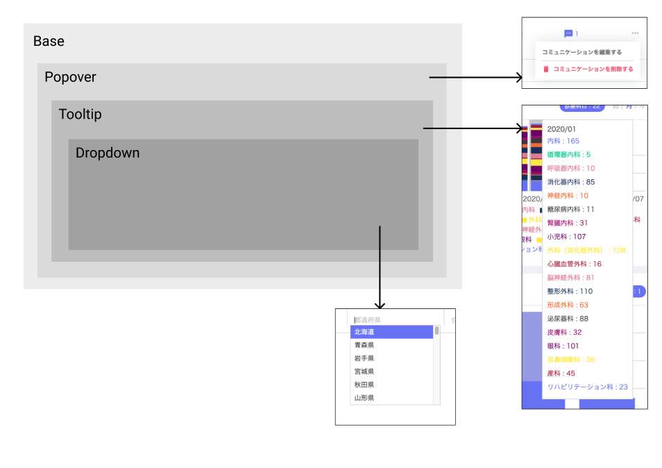

# z-index 管理について

## 前提

### z-index は global.scss 内でまとめて管理する

各 z-index がコンポーネント毎でバラバラに定義してしまうと、規模が拡大するにつれ管理がし辛くなる為

### z-index とかスタックコンテキストって何？

ここご参照ください

[君は真に理解しているか？z-indexとスタッキングコンテキストの関係](https://ics.media/entry/200609/)

---

## 現状の問題点

```scss
--z-index-base: 100;
--z-index-popover: var(--z-index-base); 
--z-index-tooltip: calc(var(--z-index-popover) * 10);
--z-index-modal: calc(var(--z-index-tooltip) * 10);
--z-index-card: calc(var(--z-index-modal) * 10);
--z-index-dropdown: calc(var(--z-index-card) * 10);
--z-index-toast: calc(var(--z-index-dropdown) * 10);
--z-index-scrim: calc(var(--z-index-toast) * 10);
```

- プロパティができる毎に * 10 している為、 z-index の最大数(2147483647)にいずれぶつかる
- すべてのプロパティが依存形式になると、一つのプロパティに変更があった際、他も変更しなくてはならない
- モーダルも含めた数値になっている為、管理のやり方が少しおかしい
    - 例えば今の z-index は modal < dropdown なので、もしモーダルとドロップダウンが同時に存在した時（今のところ無いけど）ドロップダウンが上に来てしまう
    
    
    

## 改善案

まず、レベルを考える

- Lv1 Base（通常時にスタックコンテキストが発生するコンポーネント）
- Lv2 Modal（モーダルが存在する場合）
- Lv3 外部コンポーネントのスタックコンテキスト
- Lv4 最上位レイヤー（toast・scrim）

### Lv1 Base

モーダルが存在しない場合の z-index をここで考慮

また、現状は全 z-index が依存関係になっているが



重複して表示されることはないものは**同じ z-index 値**で良い

（例：クリック時に発動する Popover や Dropdown 。これらは同時に表示されない為）


一方で、↑のコンテンツを表示中に別で表示される可能性があるものに関しては、

一つ上の z-index にする

（例：マウスホバーした時に発動する Tooltipなど）


以上をまとめると、このようなレイヤーとなる


具体的な z-index 値はこのような形

```scss
--z-index-base: 100;
--z-index-popover: calc(var(--z-index-base) + 10);
--z-index-dropdown: calc(var(--z-index-base) + 10);
--z-index-tooltop: calc(var(--z-index-base) + 20);
```

※ただし、DatePicker および DateRangePickerで表示されるメニューは、Lv1 では扱わない（理由は後述）

---

## Lv2 Modal

### Modal について

Modal コンポーネントが表示される時は、Lv1 より優先度が高くなります。


```scss
--z-index-modal: 200;
```

### Modal コンポーネント外で Lv1 が存在している時

modal の z-index 値の方が高くなるのでOK


### Modal コンポーネント内で Lv1 が存在している時

modal コンポーネントがスタッキングコンテキストを持つ為、lv1 コンポーネントの z-index は

気にしなくてOK


---

## Lv3 外部コンポーネントのスタックコンテキスト

DatePicker および DateRangePicker は、コンポーネントマウント時に body タグ直下の最下層に作成されます。

```tsx
<body>
  <Layout>
    ... // この中で Lv1 のコンポーネントが基本的に表示されます
  </Layout>
  <div id="modal-root">
    ... // モーダルコンポーネントが表示される時は、ここ
  </div>
  ~省略~

  <div>
    ... // DatePicker / DateRangePicker が表示される時は、ここ
  </div> 
</body>
```

その為、Modal コンポーネントよりも高くなる数値で設定します。

```scss
--z-index-datePicker: 300;
--z-index-dateRangePicker: 300;
```

---

### Lv4 最上位レイヤー（toast・scrim）

Toast および Scrim コンポーネントは、あらゆる状態の中で一番前に来てほしいスタックコンテキストである為、

```scss
--z-index-scrim: 400;
--z-index-toast: 500; // この2つがどちらも表示される場合は、 toast を優先させる
```

と設定します。

---

## まとめ

```scss
--z-index-base: 100;
--z-index-popover: calc(var(--z-index-base) + 10);
--z-index-dropdown: calc(var(--z-index-base) + 10);
--z-index-tooltop: calc(var(--z-index-base) + 20);

--z-index-modal: 200;

--z-index-datePicker: 300;
--z-index-dateRangePicker: 300;

--z-index-scrim: 400;
--z-index-toast: 500; // この2つがどちらも表示される場合は、 toast を優先させる
```