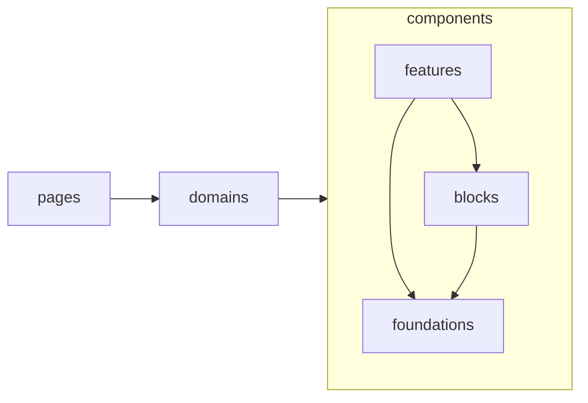

# フロントエンド開発のお約束

Created: 2021年2月18日 12:49
Tags: フロントエンド, 実装フェーズ, 設計図, 開発計画作りフェーズ

# 概要

フロントエンド開発のガイドラインです。設計・コーディングの指標として参考にしてください。

- pagesはルーティング階層を表しdomainsに処理を移譲する
- domainsはページ全体のコンポーネント
- featuresはドメイン固有の知識を持つ共通コンポーネント
- blocks, foundationsはドメイン固有の知識を持たない共通UI部品
- blocksは頻繁に使うfoundationの組み合わせをコンポーネントとして定義したもの

[フロントエンド開発のお約束詳細](%E3%83%95%E3%83%AD%E3%83%B3%E3%83%88%E3%82%A8%E3%83%B3%E3%83%89%E9%96%8B%E7%99%BA%E3%81%AE%E3%81%8A%E7%B4%84%E6%9D%9F%E8%A9%B3%E7%B4%B0%201ba1da5a7f3b80c6ba1dcb8611b6a6d3.csv)