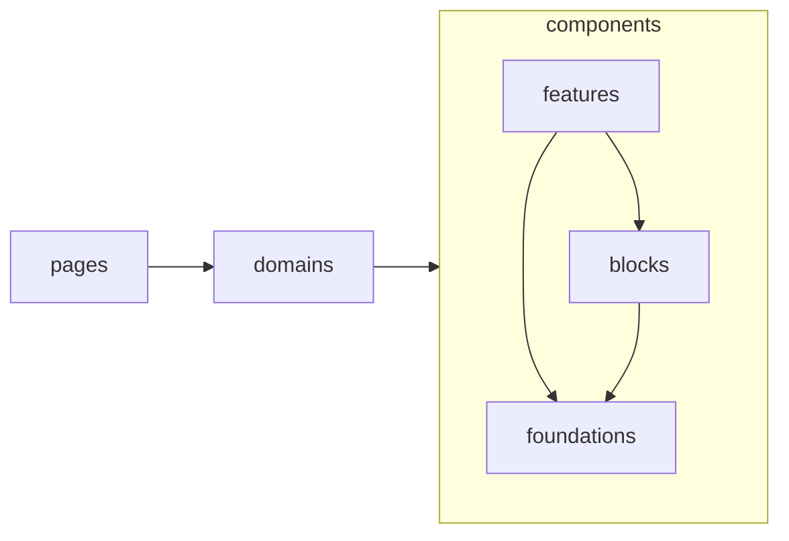

# フロントエンド開発のお約束

Created: 2021年2月18日 12:49
Tags: フロントエンド, 実装フェーズ, 設計図, 開発計画作りフェーズ

# 概要

フロントエンド開発のガイドラインです。設計・コーディングの指標として参考にしてください。



- pagesはルーティング階層を表しdomainsに処理を移譲する
- domainsはページ全体のコンポーネント
- featuresはドメイン固有の知識を持つ共通コンポーネント
- blocks, foundationsはドメイン固有の知識を持たない共通UI部品
- blocksは頻繁に使うfoundationの組み合わせをコンポーネントとして定義したもの

[フロントエンド開発のお約束詳細](%E3%83%95%E3%83%AD%E3%83%B3%E3%83%88%E3%82%A8%E3%83%B3%E3%83%89%E9%96%8B%E7%99%BA%E3%81%AE%E3%81%8A%E7%B4%84%E6%9D%9F%E8%A9%B3%E7%B4%B0%201ba1da5a7f3b80c6ba1dcb8611b6a6d3.csv)

---

# 全体像

分類: ディレクトリ構成

## 全体のディレクトリ構成

```markdown
├── README.md
├── .env // 環境変数
├── .storybook // storybook の設定ファイル
├── public
├── src
│   ├── @types
│   ├── api // http client (openapi-generator / trpc から自動生成)
│   ├── domains // 機能ごとのまとまり (詳細は後述)
│   ├── components
│   │   ├── features // あるドメイン(機能)に特化した使い回すコンポーネント群
│   │   ├── blocks // 基底コンポーネントの組み合わせて、よく利用される特定のユースケースに特化したコンポーネント群
│   │   └── foundations // 基底コンポーネント群 - デザインシステムとの連動
│   ├── error // アプリケーションで利用する独自エラーの定義
│   │   └── fetchError
|   ├── hooks // 汎用性の高い hooks
│   ├── layouts // レイアウトコンポーネント
│   ├── middlewares // 認証などのミドルウェア層コンポーネント
│   ├── mocks // テスト用のswcモック置き場
│   ├── pages // ページコンポーネント
│   ├── types // アプリケーション内部で利用するグローバルな型定義
│   └── utils // 便利関数たち 
├── styles // グローバルなスタイル
```

---

# 全共通ガイドライン

分類: コーディング

## 命名ルール

- コンポーネント
    - Presentationalコンポーネントは〇〇Presenter
        - （例）Task であれば TaskPresenter
    - リストは〇〇List、子要素は〇〇ListItem
- 術語目的語関係
    - `述語`が先、`目的語` が後
    - ◯AddHoge　×HogeAdd
- 要素の作成・追加
    - `Add` を使用
    - ◯AddHoge　×CreateHoge
- 要素の編集・更新
    - `Edit` を使用
    - ◯EditHoge　×UpdateHoge
- 要素の削除
    - `Delete` を使用
    - ◯DeleteHoge　×RemoveHoge
- 表示, 非表示を表す
    - `show` / `hide` で統一
    - （例） showModal / hideModal
- boolean を表す
    - `isHoge` で統一
    - （例）isShown / isChecked
- モーダル
    - Modal で統一
    - ◯Modal　×ModalDialog
- サイドピーク
    - SidePeakで統一
    - （例）HogeSidePeak

---

# TypeScriptガイドライン

分類: コーディング

### 変数を持たせる場合は、意味を持てるものを用意する

例えばこの `nowDate` が、2箇所以上発生する場合では、変数化することで同じ概念を扱うことを明記します

```tsx
const nowDate = New Date();

if (nowDate < hoge) {
  console.log(nowDate);
}
```

### propsは原則、分割代入して使用しない

```tsx
// ❌
const {hogera, fugara} = props.hoge;

return <Piyo hogera={hogera} fugara={fugara} />

// ------------

// ✅　　
return <Piyo {...props.hoge} />
```

分割代入だと

- シンプル
- デフォルト値が使える

展開しない形だと

- propsということがわかりやすい
- スプレッド構文で子のReact要素に渡しやすい場合がある

と、特徴がそれぞれあるが、**メダップではpropsは原則、分割代入して使用しない**ことにします。

参考

[https://twitter.com/takepepe/status/1258025262949691392?s=20](https://twitter.com/takepepe/status/1258025262949691392?s=20)

ただし例外として **初期値を設定する必要がある場合だけ許容** とします。

```tsx
const obj = { bar: 2 };
const { bar, foo: foo = 'foo' } = obj;
```

注意: この項目は配列(タプル)の分割代入についてではなく、オブジェクトの分割代入についての内容です。

### useFormWrapperは、分割代入しない

```jsx
// ❌
const { register, watch, errors } = useFormWrapper<HogeMap>(...);

// ✅
const form = useFormWrapper<HogeMap>(...);
```

※「propsは原則、分割代入して使用しない」と同じですが念のため記入

### () ⇒ void ではなく、VoidFunction で設定する

型で `() => void`となる時は `VoidFunciton` を使いましょう。

（※ `(v: hoge) => void`となる場合はそのままでOK）

### form 関係の props は、form 属性にまとめる

```jsx
// ❌
return (
  <LoginFormPresenter
    {...props}
    login={{ ...form.register('login'), errorMessages: [] }}
    password={{ ...form.register('password'), errorMessages: [] }}
    isDisabled={checkIsSubmitDisabled(inputMap)}
    onSubmit={form.handleSubmit(onSubmit)}
  />
);

// ✅
return (
  <LoginFormPresenter
    {...props}
    form={{
      login: { ...form.register('login'), errorMessages: [] },
      password: { ...form.register('password'), errorMessages: [] },
      isDisabled: checkIsSubmitDisabled(inputMap),
      onSubmit: form.handleSubmit(onSubmit),
    }}
  />
);
```

### ビュー上で「データが無い」を表す “-” の記述方法について

データが無い場合をブラウザ上で表示させる際は、原則として `-` を表示させます。

その際は、src/utils/emptyText を使用してください。

```tsx
// ❌
<div>名前: -</div>

// ✅
<div>名前: {emptyText()}</div>
```

---

# フロントで扱うモデルについて

分類: 設計・ツール

1. spa内のUIで利用しやすいデータ形式をreducerのStateとして定義して利用する。
    1. StateからAPIリクエストの生成はmapperとして作成する
    2. APIリクエスト・レスポンスはqueryの場合は基本的にuseSWRを利用して管理する
    3. commandの場合はuseSWRは基本的に利用せず、直接APIを利用する
2. 専用のViewModelを用意するほど複雑さがない場合はopenapi-generatorで生成されるデータ形式をそのまま利用する
    
    [API追加、形式変更の際の開発フロー with swagger, openapi-generator](https://app.notion.com/p/API-with-swagger-openapi-generator-d9ea373ceaa1412f808191bea5f9087e?pvs=21)

---

# state設計の方法

分類: 設計・ツール

## 概要

- フロントエンドの機能追加（※）ではデータフローを整理・把握しておくことが肝になる。
- 機能追加開発をする場合、データフローを明確化する目的で必ず事前にstate設計を行うこととする。

※UIコンポーネント作成の場合はstate設計は重要ではない

ここで指しているstateとは画面が持っている状態からformとAPI取得結果を除いたもの（=reducerで管理する対象）。以下にstate設計の考え方、アウトプット、実施手順について記載する。

## 考え方

- Reactは状態（state + form + API取得結果）をUIに変換する仕組み
- 必要最小限の独立したstateを持たせる
- 他のstateから計算可能な状態はstateとして持たせない
- 他のstate変更時に依存して変更する必要があるstateを整理

## アウトプット

state同士の関係を依存関係グラフとして記載。きれいにしない

[https://www.figma.com/board/sJDbkbVjWFBw8yaJGWuvG9/%5Bstate%E8%A8%AD%E8%A8%88%5D%E9%80%A3%E6%90%BA%E5%85%88%E3%83%95%E3%82%A3%E3%83%BC%E3%83%89%E3%83%90%E3%83%83%E3%82%AF?node-id=0-1&p=f&t=YpFt5vzCoQuAA0Nc-0](https://www.figma.com/board/sJDbkbVjWFBw8yaJGWuvG9/%5Bstate%E8%A8%AD%E8%A8%88%5D%E9%80%A3%E6%90%BA%E5%85%88%E3%83%95%E3%82%A3%E3%83%BC%E3%83%89%E3%83%90%E3%83%83%E3%82%AF?node-id=0-1&p=f&t=YpFt5vzCoQuAA0Nc-0)

## 手順

- 画面で扱うデータの洗い出し
    - UIから以下を抜き出す
    - ユーザーが操作によって変更可能なUI要素
- 分類とデータの依存関係の整理
    - APIから取得した結果（or それを変形したもの） → useSWRで管理
        - APIから取得した結果はuseSWRで管理する
        - ↑を変形したもの → 場合に応じてuseMemoで変形結果をキャッシュ
    - Aを変更したらBも追随して変更することがある
        - Bはユーザーの入力によっても変わる → stateとして持つ
        - Bが他のstateによってのみ決まる → stateとして持つ必要はない
- formを持つModal、SidePeakは切り出し、それ単体でformとstateを持たせる
    - 利用側にはformでのみ利用するstateは持たせない
    - 基本的にformのデフォルト値とonSubmitを入出力とする
    - formが参照するデータ（診療科一覧など）を渡すことは許可

---

# コンポーネントの分離によるuseEffectの除去を推奨

分類: 設計・ツール

※基本的に利用しなくてよいuseEffectはなるべく利用しないようにしていく

**■ IndexコンポーネントとContainerコンポーネントに分けることで、副作用を局所的にしていく**

- Indexコンポーネント: 外部からimportされるコンポーネント。すべての親
    - ここで、外部通信など副作用が大きな処理, 初期描画で必要なデータフェッチを終わらせておく
- Containerコンポーネント: 必要なロジックを集めて、Presenter (描画用コンポーネント) に受け渡すコンポーネント
    - Index から初期値を受け取り、各ロジックに初期値を受け渡す
    - useForm や useState, useAction など、具体のロジックを集約させる
        - 各ロジックは、form, state(Reducer), action に記載する (各切り出しを参照)

以下、サンプル

[](https://github.com/MedUpInc/refery/blob/develop/apps/web/src/features/gst/SetupSettings/index.tsx)

```tsx
// 初期描画で必要となるデータフェッチ等は、コンポーネント毎切り分けておく
export const SetupSettings: React.FC = () => {
	// 一部省略している

  const { data, error } = useFetch('/gst/my-guest', () =>
    guestApi.getMyGuest(),
  );
  if (error) throw error;

  return (
    <Loading data={data}>{(loaded) => <Container data={loaded} />}</Loading>
  );
};

type ContainerProps = {
  data: GetMyGuestResponse;
};

// 初期データは、Propsで受け取り、こちらでは、各フォームやアクション、state管理ロジックを注入して、Presenterに渡す
export const Container: React.FC<ContainerProps> = (props) => {
  const { form } = useSetupForm(props.data);
  const { save } = useAction();

  return (
    <SetupSettingsPresenter
      form={form}
      profile={props.data}
      onClickNext={form.handleSubmit(save(form))}
    />
  );
};
```

```tsx
// 左のサンプルが、すべて同じコンポーネント内になっているケース
export const SetupSettings: React.FC = () => {
	// 一部省略している

  const { data, error } = useFetch('/gst/my-guest', () =>
    guestApi.getMyGuest(),
  );
  if (error) throw error;

  // data は初期値では undefined になってしまうため、初期化はuseEffectを使用する必要が出てくる
	const { form } = useSetupForm();
  useEffect(() => {
    if (data) {
      // 省略 form.setValues
    }
  }, [data]);

  const { save } = useAction();

  return (
    <SetupSettingsPresenter
      form={form}
      profile={props.data}
      onClickNext={form.handleSubmit(save(form))}
    />
  );
};

```

上記サンプルのように、データフェッチの結果でハンドリングするようなものが増えてくると(今回で言うformの初期化)、副作用(useEffect)が増え、どんどん見通しが悪くなってくるので、コンポーネント単位で責務を分離することを推奨している

---

# z-index 管理について

## 前提

### z-index は global.scss 内でまとめて管理する

各 z-index がコンポーネント毎でバラバラに定義してしまうと、規模が拡大するにつれ管理がし辛くなる為

### z-index とかスタックコンテキストって何？

ここご参照ください

[君は真に理解しているか？z-indexとスタッキングコンテキストの関係](https://ics.media/entry/200609/)

---

## 現状の問題点

```scss
--z-index-base: 100;
--z-index-popover: var(--z-index-base); 
--z-index-tooltip: calc(var(--z-index-popover) * 10);
--z-index-modal: calc(var(--z-index-tooltip) * 10);
--z-index-card: calc(var(--z-index-modal) * 10);
--z-index-dropdown: calc(var(--z-index-card) * 10);
--z-index-toast: calc(var(--z-index-dropdown) * 10);
--z-index-scrim: calc(var(--z-index-toast) * 10);
```

- プロパティができる毎に * 10 している為、 z-index の最大数(2147483647)にいずれぶつかる
- すべてのプロパティが依存形式になると、一つのプロパティに変更があった際、他も変更しなくてはならない
- モーダルも含めた数値になっている為、管理のやり方が少しおかしい
    - 例えば今の z-index は modal < dropdown なので、もしモーダルとドロップダウンが同時に存在した時（今のところ無いけど）ドロップダウンが上に来てしまう
    
    
    

## 改善案

まず、レベルを考える

- Lv1 Base（通常時にスタックコンテキストが発生するコンポーネント）
- Lv2 Modal（モーダルが存在する場合）
- Lv3 外部コンポーネントのスタックコンテキスト
- Lv4 最上位レイヤー（toast・scrim）

### Lv1 Base

モーダルが存在しない場合の z-index をここで考慮

また、現状は全 z-index が依存関係になっているが


重複して表示されることはないものは**同じ z-index 値**で良い

（例：クリック時に発動する Popover や Dropdown 。これらは同時に表示されない為）


一方で、↑のコンテンツを表示中に別で表示される可能性があるものに関しては、

一つ上の z-index にする

（例：マウスホバーした時に発動する Tooltipなど）


以上をまとめると、このようなレイヤーとなる


具体的な z-index 値はこのような形

```scss
--z-index-base: 100;
--z-index-popover: calc(var(--z-index-base) + 10);
--z-index-dropdown: calc(var(--z-index-base) + 10);
--z-index-tooltop: calc(var(--z-index-base) + 20);
```

※ただし、DatePicker および DateRangePickerで表示されるメニューは、Lv1 では扱わない（理由は後述）

---

## Lv2 Modal

### Modal について

Modal コンポーネントが表示される時は、Lv1 より優先度が高くなります。


```scss
--z-index-modal: 200;
```

### Modal コンポーネント外で Lv1 が存在している時

modal の z-index 値の方が高くなるのでOK


### Modal コンポーネント内で Lv1 が存在している時

modal コンポーネントがスタッキングコンテキストを持つ為、lv1 コンポーネントの z-index は

気にしなくてOK


---

## Lv3 外部コンポーネントのスタックコンテキスト

DatePicker および DateRangePicker は、コンポーネントマウント時に body タグ直下の最下層に作成されます。

```tsx
<body>
  <Layout>
    ... // この中で Lv1 のコンポーネントが基本的に表示されます
  </Layout>
  <div id="modal-root">
    ... // モーダルコンポーネントが表示される時は、ここ
  </div>
  ~省略~

  <div>
    ... // DatePicker / DateRangePicker が表示される時は、ここ
  </div> 
</body>
```

その為、Modal コンポーネントよりも高くなる数値で設定します。

```scss
--z-index-datePicker: 300;
--z-index-dateRangePicker: 300;
```

---

### Lv4 最上位レイヤー（toast・scrim）

Toast および Scrim コンポーネントは、あらゆる状態の中で一番前に来てほしいスタックコンテキストである為、

```scss
--z-index-scrim: 400;
--z-index-toast: 500; // この2つがどちらも表示される場合は、 toast を優先させる
```

と設定します。

---

## まとめ

```scss
--z-index-base: 100;
--z-index-popover: calc(var(--z-index-base) + 10);
--z-index-dropdown: calc(var(--z-index-base) + 10);
--z-index-tooltop: calc(var(--z-index-base) + 20);

--z-index-modal: 200;

--z-index-datePicker: 300;
--z-index-dateRangePicker: 300;

--z-index-scrim: 400;
--z-index-toast: 500; // この2つがどちらも表示される場合は、 toast を優先させる
```

---

# テスト方針

分類: 設計・ツール

## 方針

以下に対してテストを記載して挙動を担保してください。

- reducer
- ~~action~~
- selector
- mapper
- utils

UIに対するスナップショットテストなどは費用対効果を勘案して実施しない方向です。

---

# CSSガイドライン

分類: コーディング

### フォントや3点リーダーなどのモジュール

stylesの配下に _texts.scss などのファイルにモジュール化されたものがあるので、`@import 'styles/texts';` してモジュールを適用する。

### レイアウトコンポーネントを利用する

基本的に以下のレイアウトコンポーネントを利用してmargin、gapを設定する

- Stack：childrenコンポーネントを縦並びで配置
- Cluster：childrenコンポーネントを横並び
- Section：paddingを設定できる

### スタイルクラス名はネストさせない

```scss
// ❌
.hoge {
  ...
  .fuga {
    ...
  }
}

// ✅
.hoge {
 ...
}

.fuga {
  ...
}
```

ネストさせる方のメリットもあるが、させない方が

- スタイルクラスごとに記述できる為、比較的書きやすく、コンポーネントを切り離しやすい
- ビルドした時のコード量がネストさせる時より少ない

などの理由である為。

### z-indexの管理

以下のページを参照

[z-index 管理について](z-index%20%E7%AE%A1%E7%90%86%E3%81%AB%E3%81%A4%E3%81%84%E3%81%A6%2099af91d66e344a86982cb399a7b83820.md)

---

# domains, features

分類: ディレクトリ構成

### ディレクトリ構成

```markdown

├── domains(features)
│   ├── Tasks // 各機能が並ぶイメージ。ここではサンプルとしてタスク機能をあげている
│   │   ├── __tests__ // 各テストの置き場
│   │   ├── index.tsx // IndexコンポーネントとContainerコンポーネントの置き場
│   │   ├── presenter.tsx // Presenterコンポーネントの置き場
│   │   ├── presenter.sp.tsx // SP用Presenterコンポーネントの置き場
│   │   ├── styles.module.scss // スタイル
│   │   ├── form.ts // フォームロジック
│   │   ├── action.ts // アクションロジック
│   │   ├── reducer.ts // state管理ロジック
│   │   ├── selector.ts // 描画ロジック
│   │   ├── mapper.ts // 値の変換ロジック（描画に関連するものを除く）
│   │   └── components // Presenterから分割したサブコンポーネント（※）
│   │        ├── Table.tsx
│   │        ├── Table.module.scss
│   │        ├── Table.module.scss.d.ts
│   │        ├── ...
```

※内部に複雑なstateやformを持つ必要があるModalやSidePeakは別途ルール化します

**コンポーネントの種類**

- Indexコンポーネント: 外部からimportされるコンポーネント。すべての親
    - 外部通信など副作用が大きな処理, 初期描画で必要なデータフェッチを行い、Containerコンポーネントに引き継ぐ
- Containerコンポーネント: 必要なロジックを集めて、Presenter (描画用コンポーネント) に受け渡すコンポーネント
    - Index から初期値を受け取り、各ロジックに初期値を受け渡す
    - 切り出された useForm や useState, useAction など、具体のロジックを集約させる
    
    ※ データフェッチ等が存在しない機能では、Containerコンポーネントをexportして、外部から参照可能にする(Indexを省略する)
    
- Presenterコンポーネント: 描画用コンポーネント
    - Container から受け取ったロジックを実際の描画に適応させる
    - 表示ロジックが複雑な場合は、selectorに切り出す

**※ indexコンポーネントの責務もContainerコンポーネントの責務も不要な場合は、index.tsxとして直接Presenterコンポーネントを組み込む形でOK！**

【参考】

[https://www.yuuniworks.com/blog/presentational-component-and-container-component](https://www.yuuniworks.com/blog/presentational-component-and-container-component)

[https://medium.com/@dan_abramov/smart-and-dumb-components-7ca2f9a7c7d0](https://medium.com/@dan_abramov/smart-and-dumb-components-7ca2f9a7c7d0)

**■ 切り出す関心事**

- useXXXForm (ex: useEditFormなど) → form.ts
    - フォームロジックの切り出し
        - → フォームスキーマや初期化を受け持つ
    - 具体の実装としては、zod, react-hook-form を採用している

[](https://github.com/MedUpInc/refery/blob/develop/apps/web/src/features/gst/SetupSettings/form.ts)

- useAction → action.ts
    - ユーザーアクションロジックの切り出し
        - → save、csv出力等の非同期通信を伴うユーザーアクションの切り出し

[](https://github.com/MedUpInc/refery/blob/develop/apps/web/src/features/gst/SetupSettings/action.ts)

- useXXXState (ex: useTaskStateなど) → reducer.ts
    - 複雑なstate管理の切り出し
        - stateの更新に合わせて、他のstateを更新するなど、複雑なstate管理が必要な場合は、切り出して管理する
        - ↑ このケースでは、useStateとuseEffectの組み合わせではなく、useReducer を推奨している

[](https://github.com/MedUpInc/refery/blob/develop/apps/web/src/features/tnt/WorkShift/reducer.ts)

- selector → selector.ts
    - Presenterコンポーネント内で描画する際に、描画ロジックが複雑なものを関数に切り出しておく
        - → 単体テストを書きやすくして保守性を上げる狙い
        - & 全体の見通しが良くなる

[](https://github.com/MedUpInc/refery/blob/develop/apps/web/src/features/tnt/WorkShift/selector.ts)

- mapper → mapper.ts
    - APIリクエストパラメーターの組み立てなど、描画に関係がない値の変換ロジックを関数に切り出しておく
- fetcher → src/app/hooks/fetcher/getXxxxx.ts
    - データフェッチは常にグローバルのhooks/fetcherに切り出しておく

**■SP版の表示切り替えについて**

SP表示に対応している画面では、Presenter（およびサブコンポーネント）でウィンドウサイズを判定して表示の切り替えを行う。切り替え単位は以下の3パターンとし、切り分けの範囲によって使い分ける

1. Presenter内でuseResponsiveを利用して一部分の表示を切り替える
2. Presenter自体をpresenter.tsx or presenter.sp.tsxとして切り分ける
3. Presenterから分離したサブコンポーネントを ListItem or ListItemSpのように分ける

---

# foundations

分類: ディレクトリ構成

### foundation層の構成

foundation 層は大枠の責務に応じて、コンポーネントをグルーピングしています

- Buttons (ボタンとして使われるもの)
    - Button
    - FileInputButton
    - TextButton
    - Chip
- Chart (チャートで使われるもの)
    - BarChart
    - BarChartTooltip
    - LineChart
    - ChartPagination
- DataDisplay (情報の表示として使われるもの)
    - Card
    - Img
    - Label
    - Tag
    - Tooltip
    - TooltipList
- FeedBack (ユーザーのアクションに対して使われるもの)
    - LoadingCircle
    - Toast
- Layout (レイアウトとして使われるもの)
    - CenteringContainer
    - Divider
    - Stack (縦並び)
    - Cluster (横並び)
    - Section (margin/padding取れる)
- Form (フォーム関連で使われるもの)
    - Checkbox
    - DatePicker
    - DateRangePicker
    - MonthPicker
    - ErrorMessages
    - Input
    - TextField
    - NumberInput
    - NumberInputField
    - Radio
    - RadioGroup
    - SelectBox
    - Textarea
    - TextareaField
- Navigation (ナビゲーションとして使われるもの)
    - Pagination
    - Tab
- Util (その他、便利UIとして使われるもの)
    - Accordion
    - ModalDialog
    - 🚧 Scrim (Backdrop との分離を行う)
    - Popover
    - PopoverMenu
    - SidePeak
    - Link (CSNのため)

---

# (wip)react-hook-formのスキーマガイドライン

分類: コーディング

[https://medup.slack.com/archives/C06H1QVRLDT/p1768816570628029](https://medup.slack.com/archives/C06H1QVRLDT/p1768816570628029)

TODO 主にselectの非選択状態への対応としてフォームで扱うスキーマと、出力スキーマを分けて扱える仕組みとルールを整備する